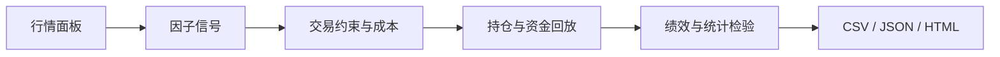
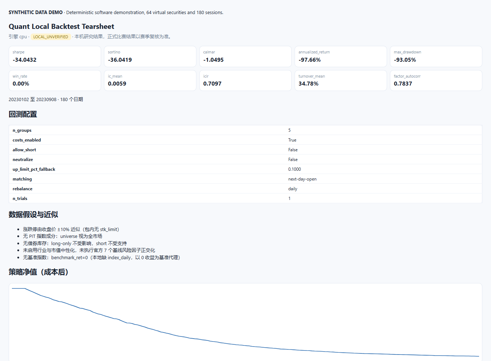

<div align="center">

# SingSeq Quant Research

**覆盖交易执行、账户状态、成本与统计评估的本地量化回测系统**

A local backtesting system for factor and portfolio research, with stateful execution, trading costs and reproducible reports.

[](https://github.com/weihaoyang/singseq-quant-research/actions/workflows/research.yml)
[](pyproject.toml)
[](LICENSE)

[回测系统](#回测系统) · [快速开始](#快速开始) · [使用自己的数据](#使用自己的数据) · [研究能力](#研究能力) · [给-agent-的提示词](#给-agent-的提示词) · [Quant 官网](https://quant.singseq.com)

</div>

SingSeq Quant Research 面向因子与组合研究，覆盖从行情面板、信号生成、交易执行、持仓与资金回放，到绩效分析、统计检验和报告归档的完整本地流程。

用一段 `compute_factor(df)` 表达选股想法，系统负责按配置回放交易、计入成本并生成可检查的结果。计算核心与 Quant 产品同源，面向个人研究者、课程与实验室，以及能够操作本机 Python 环境的 AI Agent。



## 回测系统

日频引擎将多资产面板计算与有状态交易回放结合起来。每次调仓都经过成交约束、资金与持仓更新，再计算成本后的表现。

| 回测环节 | 已实现的能力 |
| --- | --- |
| 信号与成交时序 | 收盘形成信号，次日开盘执行，收益按持仓时点对齐，成本与约束读取成交日信息 |
| 账户与持仓 | 现金、股数、平均成本、已实现与未实现损益，逐日资金和权益曲线，总敞口与净敞口 |
| A 股交易规则 | T+1、整手与价格精度、涨跌停、停牌、上市时间、ST 和历史股票池条件，由对应历史字段驱动 |
| 成交可实现性 | 成交参与率限制、部分成交、拒单与原因记录，保留实际执行后的持仓状态 |
| 成本与资金约束 | 佣金、日期相关印花税、冲击成本，以及可配置的融资成本、借券费率、杠杆和保证金约束 |
| 评估与归档 | 分组曲线、成本后净值、回撤、换手、IC / ICIR 与衰减，因子 CSV、JSON 和独立 HTML 报告 |

底层引擎通过 `BacktestResult` 提供交易与会计摘要 `ledger`，以及 `cash_curve`、`equity_curve` 和多空敞口序列，方便进一步核对资金与持仓。高层研究入口负责因子运行、诊断和报告导出。实现可直接查看[回测引擎](server/engine/backtest.py)、[交易状态机](server/engine/friction.py)与[本机研究入口](quant_sdk/local_backtest.py)。

日频入口采用每日调仓，分钟研究提供单证券回放与横截面聚合入口。融资融券需要相应配置和借券输入，历史可交易性依赖对应时点的数据。缺字段采用的估计会记录在 `approximations` 中。

## 快速开始

需要 Python 3.11 或更新版本。先在独立环境中安装。

```bash
git clone https://github.com/weihaoyang/singseq-quant-research.git
cd singseq-quant-research
python -m venv .venv
```

激活环境。

```powershell
# Windows PowerShell
.\.venv\Scripts\Activate.ps1
```

```bash
# macOS / Linux
source .venv/bin/activate
```

安装并运行完整演示。

```bash
python -m pip install .
python examples/quickstart.py
```

演示会生成 **64 个虚拟证券、180 个交易日的确定性构造数据**，执行 RET5 反转因子、含成本回放和基准诊断，并输出以下文件。

```text
outputs/quickstart/
├── panel.csv                     输入面板
├── factor.csv                    日期、证券、因子值
├── factor.csv.provenance.json    结果摘要与数据说明
├── report.html                   可独立打开的研究报告
└── summary.json                  输入、源码与结果的 SHA-256
```

打开 `outputs/quickstart/report.html` 查看结果。演示数据用于检查软件流程，市场研究需要使用真实、获得授权的数据。



图为上述命令生成的实际报告。价格由固定种子生成，包含交易成本，图中收益用于检查软件输出。

## 一段因子代码

因子接收按证券与交易日排序的长表，返回与输入索引对齐的 `pandas.Series`。

```python
import pandas as pd

def compute_factor(df: pd.DataFrame) -> pd.Series:
    previous = df.groupby("ts_code", sort=False)["close"].shift(5)
    return -(df["close"] / previous - 1.0)
```

这里的数学定义为

$$
f_{i,t} = -\left(\frac{P_{i,t}}{P_{i,t-5}} - 1\right)
$$

它把过去五个交易日表现较弱的股票排在前面。如何成交、成本多高、这种关系是否稳定，都需要交给后续回放和检验。

## 使用自己的数据

支持 CSV、Parquet 和本地 DuckDB。CSV / Parquet 使用以下基础长表结构。

| 字段 | 含义 | 约定 |
| --- | --- | --- |
| `ts_code` | 证券标识 | 同一证券使用稳定的字符串标识 |
| `trade_date` | 交易日期 | `YYYYMMDD` |
| `open`, `high`, `low`, `close` | OHLC | 原始价格，统一货币单位 |
| `vol` | 成交量 | 股 |
| `amount` | 成交金额 | 元，与价格和成交量保持一致 |

更完整的回放可以提供 `adj_close`、`up_limit`、`down_limit`、`st`、`list_date`、`circ_mv`、`industry_id`、`pool_membership`、`cash_dividend`、`shortable` 和 `borrow_rate`。字段含义和使用方式可直接查看[面板适配器](quant_sdk/local_backtest.py)与[交易状态机](server/engine/friction.py)。

缺少部分执行字段时，本地适配器会采用有记录的估计，并在结果的 `approximations` 中说明。需要检验历史可交易性时，请提供对应时点的真实字段和完整交易日历。DuckDB 入口适配本项目导入器生成的 staging 表，任意表结构可以先转换为 CSV / Parquet 长表。

```bash
quant-research run --file examples/ret5.py --data data/panel.parquet --start 20230101 --end 20241231 --out outputs/ret5/factor.csv --novelty --tearsheet outputs/ret5/report.html
```

日期区间应落在实际输入覆盖范围内。代码默认按因子值从高到低排序，反向选股可以在因子定义中取负号。

Python 入口可显式记录试验次数。

```python
from pathlib import Path
import pandas as pd
from quant_sdk import run_local_backtest

panel = pd.read_parquet("data/panel.parquet")
source = Path("examples/ret5.py").read_text(encoding="utf-8")
result = run_local_backtest(
    source,
    panel,
    n_groups=5,
    n_trials=1,
    with_novelty=True,
    tearsheet_path="outputs/ret5/report.html",
)
print(result["status"])
print(result["approximations"])
```

`n_trials=1` 对应一个事先固定的假设。筛选多个候选或反复调参时，应记录实际试验数量，并在统计诊断中使用对应计数。

## 研究能力

| 能力 | 实现与输出 |
| --- | --- |
| 因子分析 | Rank IC、ICIR、IC 衰减、分组表现、因子自相关与风格暴露 |
| 因子库 | Alpha158 风格特征、精选 Alpha101、OHLC 波动率、量价、动量、估值及行业因子 |
| 独立性分析 | 正负秩相关、版本化基准库、联合解释 R² 与残差 IC |
| 统计诊断 | Deflated Sharpe Ratio、PBO / CSCV、BH 校正与多重检验折扣 |
| 组合研究 | 因子收益矩阵、协方差、约束权重优化、分散程度与容量估计 |
| 时间切分 | 带标签日期的前瞻收益、purged split、横截面指标与稳定性检查 |
| 数据处理 | 供应商文件导入 staging DuckDB、字段核对和本地数据审计 |
| 自动化 | 研究脚手架、命令行运行、机器可读的能力与参数发现 |

不同因子需要不同字段。估值、资金流、行业及分钟因子应使用对应输入，缺字段会返回具体原因。`Alpha158` 表示采用该特征家族的构造方式，具体窗口与输出列由[实现](factors_catalog/alpha158.py)定义。

也可以直接选择已有因子实现，在演示面板上运行价格动量。

```bash
quant-research named --factor-name price_momentum_20 --data outputs/quickstart/panel.csv --start 20230102 --end 20230908 --out outputs/momentum/factor.csv --novelty --tearsheet outputs/momentum/report.html
```

### 成交时点与输入假设

日频引擎在收盘形成信号，于下一交易日开盘执行。成本和执行约束取成交日信息，收益区间按实际持仓时点对齐。具体会计处理以[引擎](server/engine/backtest.py)、[成本配置](server/engine/friction.py)和[回归测试](tests/test_local_backtest.py)为准。

`BacktestConfig` 控制分组、每日调仓、行业与市值中性化、IC 衰减窗口和试验计数。`FrictionConfig` 进一步提供初始资金、整手、价格精度、成交参与率、费用、杠杆与保证金等执行参数。高层因子回测默认按多头运行，底层参数可用于有相应数据支持的更细致研究。

基准收益的来源与缺字段估计都需要一起阅读。本地结果带有 `LOCAL_UNVERIFIED` 状态，研究诊断分与赛事正式成绩各有对应口径，参加 Quant 比赛时由平台按该赛季规则独立复核。

### 检验预测能力与独立性

已有因子换个符号，仍然包含相近的信息。相关性分析同时检查正负重合，完全复制某个基准时，联合解释诊断可以得到 `R² = 1`，独立变化不足时残差 IC 记为缺失。

独立性需要与预测能力、成本、样本外表现共同检验。DSR 需要试验计数，PBO 需要多个候选在共同时间段上的收益矩阵。相关实现保留输入不足和数值退化的状态，便于检查证据完整性。

`--novelty` 默认使用冻结的 `zoo-1` 价格与成交量基准库。自定义基准矩阵可以通过 `evaluation.library_correlation` 计算联合解释 R² 和残差 IC。

### 可选模型研究

```bash
python -m pip install ".[ml]"
python -m research.run_baselines --help
```

`deep_alpha/` 提供 PyTorch 数据管道、按交易日采样、训练检查点，以及 iTransformer、PatchTST、AlphaNet 研究实现。`research.run_baselines` 包含简单反转、Ridge、LightGBM 和可选 Transformer 的时间分段实验入口。模型比较需要符合契约的真实数据，参数、数据区间和输出目录由实验配置确定。

GPU 算子通过可选 PyTorch 后端执行，CPU 路径可用于基础回测。运行时结果记录实际执行模式，机器兼容性和显存需求由所选模型及面板规模决定。

## 给 Agent 的提示词

把下面这段话交给能够读取文件和执行终端命令的 AI Agent。

```text
请使用这个仓库帮我完成一项本地量化研究。

先读 README、pyproject.toml 和 quant-research capabilities，检查当前 Python
环境，在独立虚拟环境安装项目并执行 examples/quickstart.py，确认因子 CSV、
HTML 报告和 summary.json 都实际生成。先理解演示数据的构造性质。

接着检查我提供的真实数据，核对字段、证券与日期唯一性、单位、复权和交易日覆盖。
如果我还没有具体想法，先使用 examples/ret5.py。若我已有想法，先写出数学定义，
再实现 compute_factor(df)，每只股票按时间正确排序，使用当时可获得的信息。

按实际数据覆盖设置回测区间。保留源码、配置、输入与输出摘要，执行完整本机回测，
读取报告中的收益、回撤、IC、换手、成本和 approximations。用普通语言解释结果，
提出下一步可以检验的修改，记录候选和试验次数，保留每轮对照及样本外结果。

结束时给出可复现命令、报告路径、实际数据区间、已验证事实和需要补充的输入。
```

机器可读的入口与参数帮助可直接查询。

```bash
quant-research capabilities
quant-research run --help
quant-research named --help
quant-research mine --help
```

因子源码在当前 Python 研究进程中执行。AST 检查可辅助发现部分危险调用和前瞻写法，运行第三方代码时应使用单独受限的执行环境。

## 项目结构

```text
quant_sdk/         本机研究入口、面板适配、因子契约
server/engine/     纯计算回放、成本、指标、Arrow 与 GPU 算子
factors_catalog/   公式因子实现与元数据
evaluation/        基准比较、统计检验、组合与时间切分
research/          导入、审计、稳定性与模型实验脚本
deep_alpha/        时序模型、数据管道与训练循环
examples/          可运行的 RET5 与完整演示
tests/             执行、统计和数据契约回归
```

`server/engine/` 是沿用产品计算核心的模块路径。安装包按该路径提供纯 Python 计算模块。

## 验证与贡献

```bash
python run_tests.py
```

欢迎提交可复现的错误、因子实现、数据适配和数值验证。报告计算问题时，请提供可分享的最小输入、运行命令、依赖版本，以及预期和实际结果。涉及交易逻辑的改动，请补充能捕获对应回归的测试。

## 与 Quant 产品的关系

本仓库发布可独立运行的 Python 研究套件。Quant 桌面客户端、平台账号、数据服务和比赛运营由对应产品提供。行情数据与研究者自己的因子按各自授权使用，仓库中的 Apache-2.0 授权覆盖本仓库发布的代码。

软件下载、研究指南和比赛入口见[Quant 官网](https://quant.singseq.com)。

## 许可证与参考

采用 [Apache License 2.0](LICENSE)。来源和相关项目见 [NOTICE](NOTICE) 与 [第三方说明](THIRD_PARTY_NOTICES.md)。

- Alpha158 特征家族参考 [Microsoft Qlib](https://github.com/microsoft/qlib)。
- Alpha101 公式参考 [101 Formulaic Alphas](https://arxiv.org/abs/1601.00991)。
- 统计模块围绕 DSR、多重检验和回测过拟合问题提供可检查的研究实现。
